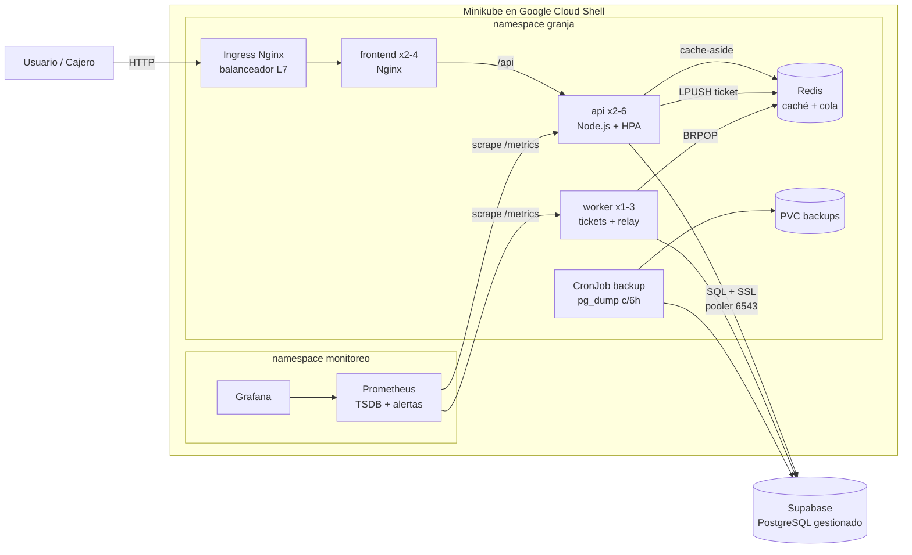

# Granja Express Cloud

Sistema de punto de venta para **Granja Express S.A.C.** (distribuidora de productos de granja, Huánuco), migrado a una arquitectura de **microservicios en contenedores**. Se orquesta con **Kubernetes**, tiene **monitoreo en tiempo real** y patrones de **resiliencia**.

Proyecto final del curso **Servicios Cloud (100000S91T) · UTP**.

## Arquitectura



| Componente | Tecnología | Función |
|---|---|---|
| `frontend` | Nginx (no root) | Web del POS + reverse proxy `/api` |
| `api` | Node.js 20 + Express | Productos, ventas, caja. Sin estado, escalable |
| `worker` | Node.js 20 | Genera tickets desde la cola; relay del outbox |
| `redis` | Redis 7 | Caché del catálogo (TTL 30 s) + cola de tickets |
| Base de datos | Supabase (PostgreSQL) | Servicio gestionado (PaaS), fuente de verdad |
| Monitoreo | Prometheus + Grafana | Métricas, tablero y 8 alertas |

## Estructura del repositorio

```
api/            API REST (Dockerfile multi-etapa)
worker/         Worker de tickets (Dockerfile multi-etapa)
frontend/       Web + Nginx (Dockerfile)
db/             schema.sql y seed.sql para Supabase
k8s/app/        Namespaces, ConfigMap, Deployments, Services, HPA, PDB,
                Ingress, NetworkPolicies, CronJob de respaldo
k8s/monitoreo/  Prometheus (RBAC) y Grafana
monitoring/     Configuración de Prometheus, alertas y dashboard de Grafana
loadtest/       Prueba de carga k6 y Job de Kubernetes
scripts/        setup, acceso, carga, caos, limpiar
docker-compose.yml   Entorno local completo (con PostgreSQL local)
```

---

## Paso 1 · Base de datos en Supabase

1. En el proyecto de Supabase entra a **SQL Editor → New query**, pega `db/schema.sql` y dale **Run**.
2. Haz lo mismo con `db/seed.sql`, que carga los productos de prueba.
3. Ve a **Project Settings → Database → Connection string → URI** y copia:
   - **Transaction pooler** (puerto **6543**) → `DATABASE_URL`
   - **Session pooler** (puerto **5432**) → `BACKUP_DATABASE_URL`

> Se usa el *pooler* porque la conexión directa de Supabase es solo IPv6 y Cloud Shell sale por IPv4.

## Paso 2 · Desplegar en Cloud Shell

```bash
git clone https://github.com/<usuario>/granja-express-cloud.git
cd granja-express-cloud
cp .env.example .env
nano .env                      # pega las dos cadenas de Supabase
chmod +x scripts/*.sh
RECREAR=1 ./scripts/setup.sh   # la primera vez: crea el clúster con Calico (unos 8 min)
./scripts/acceso.sh            # abre túneles a la app, Grafana y Prometheus
```

En Cloud Shell, abre **Vista previa web**:
- **8080**: la app.
- **3000**: Grafana (usuario `admin` / contraseña `admin`).
- **9090**: Prometheus.

> Cloud Shell borra todo lo que está fuera de `$HOME` cuando se reinicia, incluido Minikube. Si pasa, vuelve a correr `./scripts/setup.sh`.

## Paso 3 · Demostraciones

| Demo | Comando | Qué se observa |
|---|---|---|
| Escalado automático | `./scripts/carga.sh 3 20` | El HPA sube la API de 2 a 6 réplicas; Grafana muestra req/s, CPU y p95 |
| Caída de una réplica | `./scripts/caos.sh pod-api` | Kubernetes recrea el pod; las ventas siguen |
| Caída total de la API | `./scripts/caos.sh todas-api` | Autorecuperación y RTO medido en segundos |
| Caída de Redis | `./scripts/caos.sh redis` | Circuit breaker: se vende sin caché (`X-Cache: BYPASS`) |
| Caída del worker | `./scripts/caos.sh worker` | Las ventas no se pierden; los tickets se procesan al volver |
| Fallos de impresión | `./scripts/caos.sh impresora` | Reintentos con backoff y DLQ (`restaurar` para volver) |
| Firewall | `./scripts/caos.sh firewall` | El frontend no llega a Redis ni a Internet |
| Respaldo (DRP) | `kubectl -n granja create job --from=cronjob/backup-bd backup-manual` | pg_dump comprimido en el volumen |
| Balanceo | App → pestaña **Sistema** → *Probar balanceo* | Las peticiones se reparten entre pods |
| Idempotencia | Prueba k6 (20% de reintentos) | Panel *Duplicados evitados*: ninguna venta doble |

## Desarrollo local (opcional)

```bash
docker compose up -d --build
# App http://localhost:8080 · Grafana http://localhost:3000 · Prometheus http://localhost:9090
```

## API

| Método | Ruta | Descripción |
|---|---|---|
| GET | `/api/productos` | Catálogo (cache-aside con Redis) |
| POST | `/api/productos/:id/reponer` | Reponer stock `{ "cantidad": 100 }` |
| POST | `/api/ventas` | Registrar venta. **Header obligatorio** `Idempotency-Key` |
| GET | `/api/ventas` | Últimas ventas con estado del ticket |
| GET | `/api/ventas/:id/ticket` | Ticket generado por el worker |
| GET | `/api/caja/resumen` | Totales del día por método de pago |
| GET | `/api/info` | Pod que respondió, estado de Redis y del breaker |
| GET | `/api/stress?ms=30` | Carga de CPU controlada (demo del HPA) |
| GET | `/health` · `/ready` · `/metrics` | Liveness, readiness y métricas Prometheus |

Más detalle técnico en [`docs/arquitectura.md`](docs/arquitectura.md).
